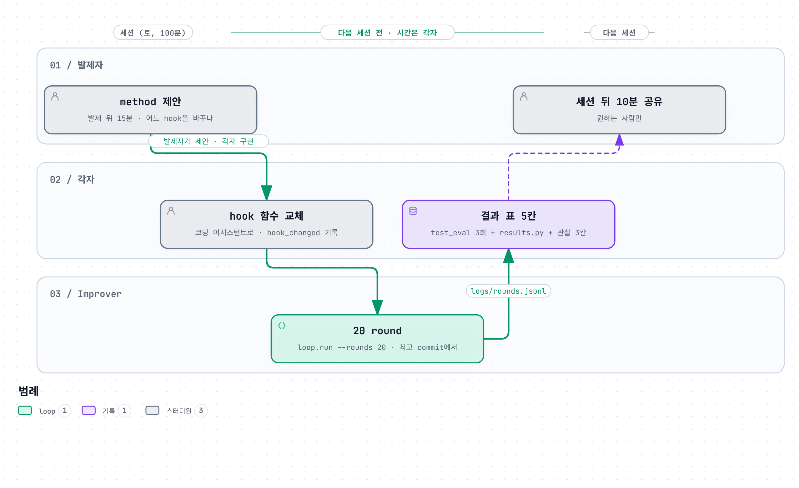

# Text-to-SQL starter (RSI 논문 스터디)

각자 **SQL agent**(질문 → SQL)와 그것을 고치는 **Improver**(loop + Improver LLM + hook 10개)를 가지고, 매주 발제 논문의 method를
hook 하나에 넣어 돌려 본 뒤 같은 양식으로 경험을 적는다. 이 repo는 그 최소 형태다.


**EVOLVE-BLOCK**: `sql_agent/run.py`와 `evaluator/rules.py` 안에서 `# === EVOLVE-BLOCK-START: <이름> ===` ~ `# === EVOLVE-BLOCK-END ===` 주석으로 감싼 구간. Improver가 고칠 수 있는 유일한 곳이다. `prompt`, `code`, `evaluator` 세 개가 있고, `config.yaml`의 `editable_blocks`에 적은 것만 이번 주에 수정이 허용된다(기본 `[prompt]`). 표기는 AlphaEvolve(DeepMind, 2025)의 `EVOLVE-BLOCK` 주석을 그대로 따랐다.

## 1. 10분 안에

```bash
pip install -r requirements.txt
cp .env.example .env      # 열어서 값을 채운다. 아래 export 대신 .env 를 써도 된다
# 기본 경로: OpenRouter (전원 같은 모델·같은 provider)
export LLM_BASE_URL=https://openrouter.ai/api/v1
export LLM_API_KEY=<OpenRouter 키>
export LLM_MODEL=qwen/qwen-2.5-7b-instruct
export LLM_PROVIDER=Phala                       # provider 고정. 양자화가 같아야 점수를 나란히 놓을 수 있음
export LLM_CONCURRENCY=8                        # 병렬 호출 수
# 로컬 LM Studio로 쓰려면: LLM_BASE_URL=http://localhost:1234/v1, LLM_MODEL=<로드한 모델 id>, LLM_PROVIDER 비움, LLM_CONCURRENCY=1
python -m scripts.test_eval --runs 3            # v0 test score (200문제 × 3회 평균)
python -m loop.run --rounds 1                   # 1 round. logs/rounds.jsonl 에 한 줄
```
- LLM 없이 loop 동작만 보려면 `LLM_BACKEND=mock` 을 붙인다. 점수는 의미 없다.
- Improver(patch를 제안하는 LLM)를 SQL agent와 다른 모델로 쓰려면 `IMPROVER_LLM_BASE_URL`, `IMPROVER_LLM_MODEL`, `IMPROVER_LLM_API_KEY`.
- 데이터(`data/`)는 운영자가 배포한 것을 그대로 쓴다. validation 100(Spider train), test 200(Spider dev), few-shot pool 300, DB 25개(약 18MB, `starter_data_database.zip`을 같은 자리에 풀면 `data/database/`가 생김). Spider는 CC BY-SA 4.0.

## 2. 폴더


| 경로 | 하는 일 | 누가 고치나 |
|---|---|---|
| `sql_agent/run.py` | SQL agent CLI. `prompt` 블록(system prompt, few-shot 선택)과 `code` 블록(`generate`: ask·run_sql로 생성→실행→수정)만 Improver가 고침 | Improver (`editable_blocks`에 적힌 EVOLVE-BLOCK 안) |
| `sql_agent/llm.py`, `schema.py` | LLM 호출, 스키마 텍스트. EVOLVE-BLOCK 밖 | 사람 |
| `evaluator/evaluate.py`, `rules.py`, `rules_v0.py` | `evaluate(pred, problems, db_dir, rules)`. `rules.py`의 `evaluator` EVOLVE-BLOCK은 6주차에 `editable_blocks`에 추가할 수 있고, test는 `rules_v0.py`(고정)로 채점 | Improver (`editable_blocks`에 추가한 뒤) |
| `loop/run.py` | round loop (아래 3) | 고정 |
| `loop/patch.py` | EVOLVE-BLOCK 교체, guard | 고정 |
| `loop/archive.py` | git commit/checkout, 최고 commit 추적 | 고정 |
| `loop/prompts/` | 진단·patch 프롬프트 | 사람 (8주차에 goal 바꾸기) |
| `hooks/*.py` | 결정 지점 10개. **매주 method는 이 중 하나의 본문을 바꾼다** | 각자 |
| `data/test.json` | test. loop는 열지 않음 | 아무도 |
| `logs/rounds.jsonl` | round당 한 줄 | loop |
| `scripts/` | 분할 생성(운영자), test 평가, 결과 표 추출 | — |

## 3. 한 round와 hook 10개

loop는 round마다 아래 순서로 돌고, 번호 붙은 곳에서 `hooks/`의 함수를 부른다. 함수 이름·인자·반환은 고정이고 본문만 바꾼다.


```
parent = select_parent(archive)                 ① 어느 commit에서 시작하나        기본: 최고 점수 commit
checkout → before = 실행·평가(validation 100)      같은 commit은 다시 재지 않음
on_round_start(ctx)                             ② round 시작 직후 할 일            기본: 없음
ctx.diagnosis = diagnose(ctx)                   ③ 틀린 문제 → 원인 한 줄           기본: LLM 1회 (diagnose.md)
patches = propose(ctx, build_prompt(ctx))       ④ 무엇을 보여 주고 ⑤ 후보를 몇 개   기본: LLM 1회, patch 1개
for patch in patches:
    patch = review_patch(ctx, patch)            ⑥ 적용 전 검토·수정·거부           기본: 그대로. None → rejected_by=review
    guard → EVOLVE-BLOCK 교체 → compile 검사 → commit
    screen(20문제)
    after_screen(ctx, before20, after20)        ⑦ full로 갈지                     기본: screen_drop(2) 이상 떨어지면 중단
    full(100문제) → after
    accept(ctx, before, after, patch)           ⑧ 남길지                          기본: noise_margin(3) 이상 오르면 새 최고
after_eval(ctx)                                 ⑨ round 뒤 기록·축적               기본: 없음
rounds.jsonl 한 줄
should_stop(ctx)                                ⑩ 일찍 멈출지                      기본: False
```
rollback은 없다. 모든 patch가 commit으로 남고, 다음 round는 `select_parent`가 고른 commit에서 시작한다.
거부 사유(`rejected_by`): `guard` EVOLVE-BLOCK 밖 수정·`editable_blocks`에 없는 블록·금지 문자열·compile 실패·변경 없음 / `review` / `screen` / `accept` / `error`.

## 4. method를 넣는 법

1. `hooks/` 안의 함수 하나(또는 둘)의 본문을 바꾼다. 시그니처는 그대로. 10개 어디에도 안 들어가는 method면 `loop/run.py`를 고쳐도 된다 (아래 6).
2. `config.yaml`의 `hook_changed`에 바꾼 hook 이름을, `week`에 주차를 적는다.
3. `python -m loop.run --rounds 20`
4. `python -m scripts.test_eval --runs 3`, `python -m scripts.results --week N` 으로 결과 표를 채운다.

hook 안에서 할 수 있는 것: `ctx` 읽기, `logs/` 아래 파일 읽고 쓰기, `ctx.llm(messages, role="improver")`로 LLM 추가 호출(호출 수는 결과 표 "비용"에).
하면 안 되는 것: `data/test.json` 열기, `sql_agent/run.py`를 직접 고치기(SQL agent 변경은 patch 경로로만), `loop/`·`evaluator/` 고치기. loop는 hook을 검사하지 않으므로 규칙으로만 지킨다.

예: Reflexion = `after_eval`에서 거부된 patch의 이유를 `logs/playbook.md`에 적고, `build_prompt`가 그 파일을 읽어 prompt에 넣는다.

`RoundContext`(`loop/context.py`): round, parent, 현재 EVOLVE-BLOCK 내용, before 평가 결과(문제별 정오·error), 문제·예측 조회, 진단, screen·after 결과, patch, accepted, 지난 log 5줄, `ctx.llm(...)`.

## 5. 주차별로 `editable_blocks`에 추가하는 것

starter에는 EVOLVE-BLOCK 세 개(`prompt`, `code`, `evaluator`)가 이미 들어 있다. `config.yaml`의 `editable_blocks`에 이름을 더하면 Improver가 그 블록을 고칠 수 있다.
무엇을 언제 열지는 발제자의 method 제안에 따른다. 아래는 Survey의 축(prompt → 코드 → 데이터 → 채점 기준 → 탐색 → 목표)을 따른 예다.



| 주차 | Improver가 수정하는 대상 (예) | 하는 법 |
|---|---|---|
| v0 | `prompt` EVOLVE-BLOCK | 기본 `editable_blocks: [prompt]` |
| 3 | Improver의 playbook | `after_eval`이 `logs/playbook.md`에 적고 `build_prompt`가 읽음 |
| 4 | `code` EVOLVE-BLOCK (SQL agent가 `run_sql`로 실행해 보고 고치는 단계) | `editable_blocks: [prompt, code]` |
| 5 | few-shot pool 축적 | `after_eval`이 맞춘 (질문, SQL)을 pool에 추가 |
| 6 | `evaluator` EVOLVE-BLOCK (validation 문제 선택·비교 규칙) | `editable_blocks: [prompt, code, evaluator]`, `accept`를 정합성 검사로. test 채점은 `rules_v0.py`(고정)라 영향 없음 |
| 7 | 탐색 | `propose`를 best-of-K, `select_parent`를 가중 선택으로 |
| 8 | goal | `loop/prompts/patch.md`의 Goal을 "점수를 올려라"로 바꾸고 guard 거부 횟수를 셈 |

## 6. 고정인 것과 자유인 것

같아야 하는 것은 **자(측정 도구)**다. 이것만 지키면 사람마다 다른 Improver를 같은 표에 놓을 수 있다.
1. 데이터: `data/validation.json`·`test.json`·`fewshot_pool.json` (6주차 전까지)
2. test 채점: `scripts/test_eval.py` + `evaluator/rules_v0.py`
3. 모델: Qwen2.5-7B-Instruct, temperature 0
4. test는 loop에 되먹이지 않는다
5. `logs/rounds.jsonl` 한 줄의 필드 (`scripts/results.py`가 읽는다)

나머지는 자유다. method가 hook 10개 중 하나에 들어가면 그 함수만 바꾸고(지름길), 안 들어가면 `loop/run.py`를 고친다. 고친 것은 결과 표 "전제 조건"에 적는다. 1~5번도 코드가 막지 않는다. 규칙으로 지킨다.
## 7. 결과 표 (매주 같은 칸)

validation 전/후 · test 전/후(3회 평균) · 비용(LLM 호출 수, 시간) · 실패 유형 · 전제 조건 · 서비스에 넣는다면(넣음/조건부/안 넣음 + 이유)
앞 두 칸은 `scripts/results.py`, `scripts/test_eval.py`가 뽑는다.

## 8. 자주 막히는 곳
- LM Studio: Developer 탭에서 서버를 켜고 모델을 로드한 뒤, `curl http://localhost:1234/v1/models` 에 나오는 id를 `LLM_MODEL`에 쓴다.
- agent timeout: `config.yaml`의 `agent_timeout_sec`(기본 1800초). 100문제 × 모델 속도.
- 점수가 전혀 안 움직이면 `temperature`는 0으로 고정돼 있으니 Improver 모델을 더 큰 것으로 바꿔 본다.
