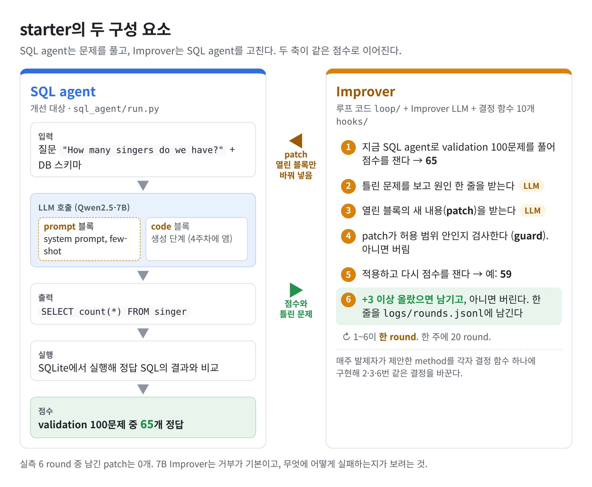
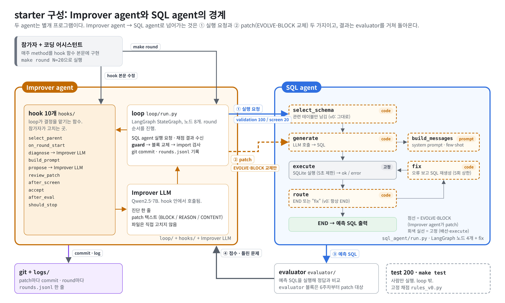
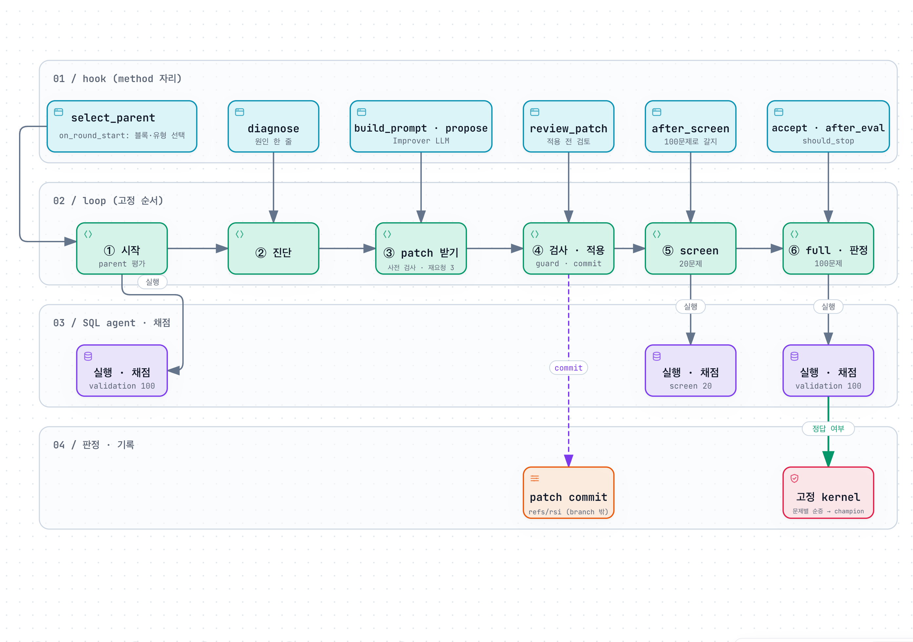

# Text-to-SQL starter (RSI 논문 스터디)

각자 두 가지를 가지고 시작한다.

- **SQL agent**: 질문을 받아 SQL을 낸다. 개선 대상이다.
- **Improver agent**: SQL agent를 고치는 장치다. loop + Improver LLM + hook 10개로 이루어진다.
  자기 방법(hook이 선언한 손잡이 값)도 스스로 다듬는다. 아래 7.

매주 발제 논문의 method를 hook 하나에 넣어 돌려 보고, 같은 양식으로 경험을 적는다.
그 위에서 Improver agent가 자기 방법을 다듬고, 그 수정안을 채택할지는 각자 정한다.
이 repo는 그 최소 형태다.

설계 이유, 데이터 형식, 주차별 로드맵 같은 배경은 [위키](https://github.com/pko89403/rsi-study-starter/wiki)에 있다.



**EVOLVE-BLOCK**은 Improver agent가 고칠 수 있는 유일한 코드 구간이다.

- `# === EVOLVE-BLOCK-START: <이름> ===` ~ `# === EVOLVE-BLOCK-END ===` 주석으로 감싼다.
- 세 개가 있다: `prompt`, `code`(`sql_agent/run.py`), `evaluator`(`evaluator/rules.py`).
- `config.yaml`의 `editable_blocks`에 적은 것만 이번 주에 수정할 수 있다. 기본은 `[prompt]`.
- 표기는 AlphaEvolve(DeepMind, 2025)의 `EVOLVE-BLOCK` 주석을 따랐다.

## 1. 10분 안에

**설치**

```bash
# uv 없으면: brew install uv  (또는 curl -LsSf https://astral.sh/uv/install.sh | sh)
make install                 # uv sync: .venv(Python 3.11) + pyproject.toml/uv.lock 의존성
cp .env.example .env         # 열어서 아래 값을 채운다
```

**`.env`** (기본: OpenRouter. 전원 같은 모델·같은 provider)

```bash
LLM_BASE_URL=https://openrouter.ai/api/v1
LLM_API_KEY=<OpenRouter 키>
LLM_MODEL=openai/gpt-4.1-nano
LLM_PROVIDER=Azure           # provider 고정 (전원 같은 서빙 조건)
LLM_CONCURRENCY=8            # 병렬 호출 수
```

- SQL agent와 Improver LLM 모두 이 모델을 쓴다. temperature는 둘 다 0으로 코드에 고정돼 있다.
- Azure OpenAI 배포가 있으면 `LLM_BASE_URL=https://<리소스>.openai.azure.com/`, `LLM_MODEL=<배포 이름>`, `LLM_PROVIDER` 비움.
- 로컬 LM Studio로 쓰려면 위키 [로컬 LM Studio](https://github.com/pko89403/rsi-study-starter/wiki/로컬-LM-Studio)를 따른다. 모델이 달라지므로 "전제 조건"에 적는다.

**실행**

```bash
make check                   # 설치 확인 (LLM 호출 없음, 약 10초): self-check + 임시 worktree에서 mock 2 round
make test                    # v0 test score (200문제 × 3회 평균)
make round                   # 20 round. N=1 이면 1 round. logs/rounds.jsonl 에 round당 한 줄
make results W=1             # 그 주의 결과 표
make meta-propose            # Improver agent가 자기 손잡이 수정안을 낸다 (아래 7)
make meta-eval               # 내 archive에서 기존 vs 수정안 짝 비교 → 판정 카드
make meta-adopt              # 수정안 채택 (본인이 정한다)
```

- v0 기준값 (gpt-4.1-nano, `ruler-v8` 데이터): validation 67/100, test 약 138/200 (3회 138·139·138). 두 split의 v0 정답 비율이 같게 뽑았다.
- 시간 (병렬 8): `make test` 약 1분 반, 1 round 약 30초, 20 round 약 10분. `make meta-eval` 10~15분.
- `make` 없이 돌리려면 `uv run`을 붙인다. 예: `uv run python -m scripts.test_eval --runs 3`. venv activate는 필요 없다.
- LLM 없이 loop 동작만 보려면 `LLM_BACKEND=mock`을 붙인다. 점수는 의미 없다.
- 데이터(`data/`)는 repo에 들어 있는 것을 그대로 쓴다.
  - validation 100 (Spider train)
  - test 200 (Spider dev)
  - few-shot pool 300
  - SQLite DB 25개
  - Spider 라이선스는 CC BY-SA 4.0.
  - 어떤 문제를 뽑았는지(주차별 고칠 거리 확보)는 [wiki 데이터 구성](https://github.com/pko89403/rsi-study-starter/wiki/데이터-구성)에 있다.

## 2. 폴더



| 경로 | 하는 일 | 누가 고치나 |
|---|---|---|
| `sql_agent/run.py` | SQL agent (LangGraph, 아래 2-1) | Improver agent (`editable_blocks`에 적힌 EVOLVE-BLOCK만) |
| `sql_agent/llm.py`, `schema.py` | LLM 호출, 스키마 텍스트 | 사람 |
| `evaluator/evaluate.py` | SQL 실행 결과를 정답과 비교 | 고정 |
| `evaluator/rules.py` | `evaluator` EVOLVE-BLOCK. 판정(accept·champion·meta)은 고정 복사본 `rules_v0`로 하므로, 열어도 점수에 영향이 없다 | (열지 않는 것을 권함, 아래 5) |
| `evaluator/rules_v0.py` | test 채점 규칙 (고정 복사본) | 고정 |
| `loop/run.py` | round loop. LangGraph `StateGraph` (아래 3) | 고정 (B는 예외, 아래 6) |
| `loop/kernel.py` | 고정 kernel: 최종 accept 판정, champion 규칙, 손잡이(KNOBS) 검사, 고정 파일 hash | 고정 |
| `loop/patch.py` | EVOLVE-BLOCK 교체, AST guard, patch 정규화 | 고정 |
| `loop/archive.py` | git commit/checkout, champion 추적 | 고정 |
| `loop/meta.py` | Improver agent 자기 개선: `meta-propose` / `meta-eval` / `meta-adopt` (아래 7) | 고정 |
| `improver/incumbent.py` | Improver agent의 손잡이 값 (`IMPROVER = {...}`, 데이터만) | Improver agent (수정안) → 각자 채택 |
| `loop/prompts/` | 진단·patch 프롬프트 | 사람 (8주차에 goal 바꾸기) |
| `hooks/*.py` | 결정 지점 10개. **매주 method는 이 중 하나의 본문을 바꾼다** | 각자 |
| `data/test.json` | test. loop는 열지 않는다 | 아무도 |
| `logs/rounds.jsonl` | round당 한 줄 | loop |
| `scripts/` | test 평가, 결과 표, Improver LLM 후보 측정(`probe_code_block`) | — |
| `examples/` | 논문 메소드를 hook으로 구현해 실제로 돌려 본 예시(3·6·7·8주차)와 실측 결과 | 참고용 (복사해서 씀) |
| `scripts/split_spec.yaml` | 고정 데이터를 만들 때 쓴 문제 유형 명세 (기록용, [wiki 데이터 구성](https://github.com/pko89403/rsi-study-starter/wiki/데이터-구성)) | 운영자 |
| `scripts/make_catalog.py`, `make_splits.py` | Spider 후보에 v0를 돌려 유형을 붙이고, 명세대로 `data/`를 만든다 (validation·test 같은 비율) | 운영자 |
| `scripts/gold_excluded.json` | 운영자가 검토한 gold 오류 77개와 사유. 데이터에 넣지 않는다 | 운영자 |

### 2-1. SQL agent의 모양

문제 하나를 graph 한 번으로 푼다. 노드는 4개(`select_schema`, `generate`, `execute`, `fix`)이고, `route`는 `execute` 뒤에서 다음 노드를 고르는 분기 함수다. 배선은 고정이고, 노드 본문과 `route` 본문만 EVOLVE-BLOCK이다.

```
START → select_schema → generate → execute → route ─┬─ "fix" → fix → execute (다시)
                                                    └─ END
```

| 노드 · 분기 함수 | 하는 일 | v0 동작 | 어디에 있나 |
|---|---|---|---|
| `select_schema` | 질문과 관련된 테이블만 남긴다 | 전체 스키마 그대로 | `code` 블록 |
| `generate` | 스키마 + few-shot → SQL | LLM 1회 | `code` 블록 (메시지는 `prompt` 블록) |
| `execute` | SQL을 읽기 전용으로 실행 (5초 상한) | 실행함 | 고정 |
| `route` (분기 함수) | END로 갈지 fix로 갈지 | 항상 END (재시도 없음) | `code` 블록 |
| `fix` | 오류를 보여 주고 SQL을 다시 받는다 | 안 불림 | `code` 블록 |

- v0는 문제당 LLM 1회로 이전과 같은 점수를 낸다.
- `route`가 무엇을 내든 fix는 문제당 5회(`MAX_FIX`, 블록 밖)를 넘지 않는다.
- 블록이 노드 이름을 빼먹으면 import 단계에서 실패하므로 guard가 거부한다.

## 3. 한 round와 hook 10개

loop는 round마다 아래 순서로 돌고, 번호 붙은 곳에서 `hooks/`의 함수를 부른다.
함수 이름·인자·반환은 고정이고 본문만 바꾼다.

코드로는 LangGraph `StateGraph` 하나다.

- 노드: `begin → diagnose → propose → review → apply → screen → full → after_eval`
- 거부되면 조건부 엣지로 바로 `after_eval`로 간다.
- `should_stop`이 False면 다음 round의 `begin`으로 돌아간다.
- hook은 노드 안에서 불리므로, hook만 바꾸는 사람은 LangGraph를 몰라도 된다.



```
parent = select_parent(archive)                 ① 어느 commit에서 시작하나        기본: champion
checkout → before = 실행·평가(validation 100)      같은 commit은 다시 재지 않음
on_round_start(ctx)                             ② round 시작 직후 할 일            기본: 없음
ctx.diagnosis = diagnose(ctx)                   ③ 틀린 문제 → 원인 한 줄           기본: LLM 1회 (diagnose.md)
patch = propose(ctx, build_prompt(ctx))         ④ 무엇을 보여 주고 ⑤ 후보를 어떻게   기본: LLM 1회, patch 1개
  평가 전 검사: 대상 블록이 맞나, 변경이 있나, 이미 시도한 patch인가, guard(AST)
  → 걸리면 이유를 붙여 다시 묻는다 (최대 3회). round당 평가하는 patch는 1개
patch = review_patch(ctx, patch)                ⑥ 적용 전 검토·수정·거부           기본: 그대로. None → rejected_by=review
guard → EVOLVE-BLOCK 교체 → compile 검사 → commit
screen(20문제)
after_screen(ctx, before20, after20)            ⑦ full로 갈지                     기본: screen_drop(2) 이상 떨어지면 중단
full(100문제) → after
accept(ctx, before, after, patch) AND kernel    ⑧ 남길지                          기본: hook은 True. kernel이 판정한다 (아래)
champion 갱신                                     accept된 commit이 champion보다 높을 때만
after_eval(ctx)                                 ⑨ round 뒤 기록·축적               기본: 없음
rounds.jsonl 한 줄
should_stop(ctx)                                ⑩ 일찍 멈출지                      기본: False
```

- **판정은 전부 고정 채점(`rules_v0`)**이다. kernel accept(`loop/kernel.py`)는 문제별로 짝지어 센다.
  - 순증 = 새로 맞힌 문제 수 − 새로 틀린 문제 수.
  - 바뀐 답이 3개 이하: 순증 ≥ 1이고 잃은 문제 0. 12개 이하: 순증 ≥ 2이고 잃은 문제 ≤ 1. 그 밖: 순증 ≥ 4.
  - 순증 ≥ 2면 얻은 문제가 2개 이상의 DB에 걸쳐야 한다.
  - `accept` hook은 이 판정과 AND로 묶인다. 조건을 더 엄격하게 할 수만 있다.
- **champion은 내려가지 않는다.** parent보다 나아서 accept돼도, champion보다 높을 때만 champion이 된다.
- rollback은 없다. 모든 patch가 commit으로 남고, 다음 round는 `select_parent`가 고른 commit에서 시작한다.
- 거부 사유(`rejected_by`):
  - `guard`: 대상 블록 아님, 변경 없음, 이미 시도함, AST guard(import·파일·프로세스·정답 접근), compile 실패
  - `review`, `screen`, `accept`(kernel 판정 미달), `error`
- `rounds.jsonl`에 남는 것: `net`, `fixed_ids`, `broken_ids`, `changed`, `kernel_accept`, `hook_accept`, `champion`, `resamples`(재요청 수), `improver_sha`, `anchors_sha`, 모델 id.
- Improver LLM 출력 상한은 `config.yaml`의 `improver_max_tokens`(기본 4096)다. 추론 모델을 쓰면 생각 토큰도 여기서 쓰므로 8192~16384로 올린다.

## 4. method를 넣는 법

운영자가 후보 논문 메소드를 실제로 구현해 돌려 본 예시가 [`examples/`](examples/README.md)에 있다. 효과·실패 이유·비용이 적혀 있다.

1. `hooks/` 안의 함수 하나(또는 둘)의 본문을 바꾼다. 시그니처는 그대로 둔다.
   hook에 안 들어가는 method는 아래 6의 B·C를 따른다.
2. method에서 Improver agent가 조절해도 되는 값은 `KNOBS`로 선언한다 (아래 7). 안 해도 된다.
3. `config.yaml`의 `hook_changed`에 바꾼 hook 이름을, `week`에 주차를 적는다.
4. `make round`
5. `make test`, `make results W=N`으로 결과 표를 채운다.
6. 원하면 `make meta-propose` → `make meta-eval` → (판정을 보고) `make meta-adopt`.

hook 안에서 할 수 있는 것:

- `ctx` 읽기
- `logs/` 아래 파일 읽고 쓰기
- `ctx.llm(messages, role="improver")`로 LLM 추가 호출 (호출 수는 결과 표 "비용"에 적는다)

하면 안 되는 것:

- `data/test.json` 열기
- `sql_agent/run.py`의 EVOLVE-BLOCK을 사람이 고치기 (SQL agent 변경은 patch 경로로만)
- `loop/*.py`·`evaluator/`·`scripts/test_eval.py` 고치기 (고정 kernel. `loop/run.py`에 노드를 더하는 B만 예외)
- `improver/incumbent.py`를 사람이 직접 고치기 (Improver agent의 수정안을 `make meta-adopt`로만)

고정 파일은 세 겹으로 지킨다.

- **코딩 어시스턴트 차단:** `.claude/settings.json`이 Claude Code의 Edit/Write 도구로 고정 파일을 고치는 것을 막는다. 셸 명령(`sed -i`, 리다이렉션)까지 막지는 못한다. 2026-10-17 Claude Code 2.1.302에서 고정 파일 10곳 Edit/Write 차단, `hooks/`·`methods/` 허용을 확인했다. `AGENTS.md`(Codex·Gemini CLI가 읽음)에 같은 목록이 있다(권고).
- **실행 거부:** `make round`·`make test`·`make meta-*`는 시작할 때 고정 파일(채점용 SQLite 포함)을 origin의 `ruler-vN` tag와 비교한다. 다르면 실행하지 않는다. tag는 origin에서 자동으로 받아 온다.
  일부러 바꾼 경우(B)에만 `RULER_OVERRIDE=1 make round`로 돌리고, `rounds.jsonl`·test 결과·`improver_ledger.jsonl`에 `ruler: override`가 남는다. tag가 없으면 `ruler: skipped`로 남는다. 그 주 결과는 "전제 조건"에 적고 `make results`가 표시한다.
- **기록:** 고정 파일 hash(`anchors_sha`)와 모델 id가 round마다, test 결과마다 남는다. `make round` 도중에 바뀌면 loop가 멈춘다.

loop는 hook 내용은 검사하지 않는다. 규칙으로 지킨다.

예: Reflexion

- `after_eval`이 거부된 patch의 이유를 `logs/playbook.md`에 적는다.
- `build_prompt`가 그 파일을 읽어 prompt에 넣는다.

`RoundContext`(`loop/context.py`)에 들어 있는 것:
round, parent, 대상 EVOLVE-BLOCK 내용, before 평가 결과(문제별 정오·error), 문제·예측 조회(정답 SQL은 없다), 진단, screen·after 결과, patch, accepted, 지난 log 5줄, `ctx.llm(...)`, `ctx.improver`(손잡이 값), `ctx.seed`(round 번호. 표본을 섞는 데 쓴다).

## 5. 주차별로 `editable_blocks`에 추가하는 것

`config.yaml`의 `editable_blocks`에 블록 이름을 더하면 Improver agent가 그 블록을 고칠 수 있다.
열린 블록은 round마다 돌아가며 대상이 된다. 이전 주에 연 블록은 닫지 않는다.
`evaluator` 블록은 열어도 판정(`rules_v0`)에 영향이 없으므로 열지 않는다. 자기 평가 method는 `review_patch`·`accept` hook에 넣는다.

주차별 예와 4주차 `code` 블록 예(노드 본문·`route`)는 위키 [주차별 로드맵](https://github.com/pko89403/rsi-study-starter/wiki/주차별-로드맵)에 있다.

## 6. 고정인 것과 자유인 것

전원이 같게 유지하는 것은 아래 **평가 조건 5개**다.
이것만 지키면 사람마다 다른 Improver agent를 같은 표에 놓을 수 있다.

1. 데이터: `data/validation.json`·`test.json`·`fewshot_pool.json` (6주차 전까지)
2. test 채점: `scripts/test_eval.py` + `evaluator/rules_v0.py`
3. 모델: SQL agent·Improver LLM 모두 gpt-4.1-nano, temperature 0 (코드 고정)
4. test 결과를 loop의 입력으로 쓰지 않는다. 사람도 test 점수를 보고 다음 주 method를 고르지 않는다 (결과 표에만 적는다)
5. `logs/rounds.jsonl` 한 줄의 필드 (`scripts/results.py`가 읽는다)

나머지는 자유다. 1·2·5번의 파일은 `ruler-vN` tag와 비교해 실행 전에 확인한다(위 4). 3·4번은 코드가 막지 않는다. 규칙으로 지킨다.
운영자는 고정 파일을 바꿀 때마다 `loop/kernel.py`의 `RULER_TAG` 번호를 올리고 `make ruler`로 tag를 단다.

method가 hook 하나에 들어가면 그 함수만 바꾼다. 안 들어가면 아래 넷 중 하나다.

**A. 새 모듈을 hook에서 부름** (대부분)

- 예: few-shot을 유사도로 고르는 retriever, playbook 관리 클래스
- 하는 법: `methods/retriever.py` 같은 파일을 만들고 `hooks/build_prompt.py`에서 import
- 기록: `hook_changed`에 hook 이름. "전제 조건"에 파일명

**B. loop에 단계가 하나 더 필요** (가끔)

- 예: screen과 full 사이의 LLM 검증자, patch 두 개를 짝지어 비교, parent 여러 개를 두는 population
- 하는 법: `loop/run.py`의 graph에 노드·엣지 추가. `rounds.jsonl` 필드는 지우거나 이름을 바꾸지 않는다(추가는 된다)
- 기록: "전제 조건"에 "`loop/run.py`에 X 노드 추가"

**C. SQL agent에 새 부품이 필요** (드묾)

- 예: 스키마 검색기, 새 도구(`explain_sql` 같은 것)
- 하는 법:
  - `sql_agent/tools.py`처럼 EVOLVE-BLOCK 밖에 helper를 만든다.
  - `sql_agent/run.py` 위쪽에 import 한 줄을 넣는다.
  - `hooks/build_prompt.py`의 `CONTRACTS["code"]` 이름 목록에 등록한다.
  - Improver LLM이 그것을 쓰는 patch를 내게 한다.
- 기록: SQL agent 기준선이 바뀌므로 "전" 점수를 다시 잰다. "전제 조건"에 적는다.

**D. 평가 조건 5개를 바꿔야 함**

- 예: validation 문제 교체, test 채점 규칙 변경, 모델 교체, `rounds.jsonl` 필드 삭제
- 안 된다. 그 주 표에 다른 사람과 나란히 놓을 수 없다.
- 하고 싶으면 표 밖에 "참고 실험"으로 따로 적는다.

참고:

- **C의 선**: 사람이 SQL agent를 고치는 것과 Improver agent가 고치는 것을 섞지 않는다.
  - helper 추가(사람)는 SQL agent 기준선을 바꾸는 변경이다. "전" 점수 재측정으로 분리한다.
  - 그 helper를 노드 본문에서 쓰는 것(Improver agent)이 method 효과다. 표의 전/후 차이로 읽는다.
  - helper를 추가하면서 `code` 블록 본문까지 사람이 바꾸면 이 분리가 깨진다.
  - 배선(`make_graph`)을 사람이 바꾸는 것도 C다.
- **hook이 못 하는 것**: 단계 사이에 끼어들기, 단계 순서 바꾸기, 여러 SQL agent를 동시에 유지하기(population), SQL agent가 쓸 수 있는 이름 늘리기. 이것들이 B·C다.
- **가중치를 학습하는 method**(self-reward, STaR 등 Training-time)는 모델이 고정이라 그대로는 안 된다.
  in-context 버전(맞춘 예시를 pool에 쌓기, 문제를 만드는 노드)으로 바꿔 체험하고 "전제 조건"에 적는다.

## 7. Improver agent의 자기 개선 (RSI 층)

참가자가 hook에 method를 넣으면, Improver agent는 그 method의 **손잡이**를 스스로 다듬는다.
"무엇을 할지"는 사람이, "얼마나·어떻게 할지"는 Improver agent가 정하는 구조다.

**손잡이 선언 (`KNOBS`)**

hook 파일에 조절 가능한 값을 선언하고, `ctx.improver`로 읽는다.

```python
# hooks/build_prompt.py
KNOBS = {
    "n_wrong":  ("int", 3, 20, 10),      # (타입, 최소, 최대, 기본값)
    "guidance": ("str", 400, ""),        # (타입, 최대 길이, 기본값)
}
KNOB_DOCS = {"n_wrong": "how many wrong examples the patch prompt shows", "guidance": "..."}   # Improver LLM이 읽는다

def build_prompt(ctx):
    n = ctx.improver.get("n_wrong", 10)
    ...
```

- 타입: `int`, `float`, `enum`(선택지 목록), `str`, `bool`. 범위 밖 값은 kernel이 기본값으로 되돌린다.
- 값은 `improver/incumbent.py`의 `IMPROVER = {...}`에 있다. 데이터만 있고 실행되지 않는다.
- 주차가 쌓이면 손잡이도 쌓인다. 이전 주 method의 손잡이도 계속 조절 대상이다.

**명령**

| 명령 | 하는 일 |
|---|---|
| `make meta-propose` | Improver LLM이 손잡이 1~2개를 바꾼 수정안을 `improver/challenger.py`에 쓴다 (가설 한 줄 포함) |
| `make meta-eval [FILE=...] [N=60]` | 내 archive의 parent·오답 표본으로 서로 다른 상황 N개를 만들고, 기존 값과 수정안이 각각 낸 patch의 순증을 짝지어 비교한다 |
| `make meta-adopt [FORCE=1 REASON="..."]` | 수정안을 incumbent로 채택하고 commit한다. 판정이 ADOPT가 아니면 FORCE와 사유가 필요하다 |

**판정 카드 읽는 법**

- `ADOPT-RECOMMENDED`: 수정안이 통계적으로 낫다(단측 p < 0.05, 같은 주 K번째 판정이면 0.05/K). 유효 patch 비율도 떨어지지 않았다.
- `KEEP`: 차이를 확인할 수 없다. 수정안의 효과가 작으면 자주 나온다. 다음 `meta-propose`는 다른 손잡이를 시도한다.
- `REJECT`: 수정안이 더 나쁘거나 유효 patch 비율이 떨어졌다.
- `NULL`: 두 버전의 Improver 입력이 같다. hook이 바뀐 손잡이를 읽지 않는 것이다.
- `COSMETIC` / `MECH-FAIL` / `HOLD`: patch가 거의 같음 / 둘 다 patch를 못 냄 / parent가 3개 미만.
- 채택 여부는 본인이 정한다. 동료가 공유한 수정안은 `FILE=`로 내 환경에서 다시 잰다. 숫자를 합치지 않는다.
- 비용: 상황 60개 기준 LLM 호출 약 5,000회, OpenRouter gpt-4.1-nano로 약 $1~2, 10~15분.
- 모든 제안·판정·채택은 `logs/improver_ledger.jsonl`에 남는다.
- 8주차: v0 값(`IMPROVER = {}`)을 `FILE=`로 넣고 새 seed(`SEED=`)로 한 번 더 잰다. 자기 수정이 실제로 효과가 있었는지 보는 지표다.

## 8. 결과 표

매주 같은 7칸을 적는다.

- validation 전/후
- test 전/후
- 비용
- 실패 유형
- 전제 조건
- 서비스에 넣는다면
- Improver 자기 수정: 제안 / 판정 / 채택 여부

칸별 설명과 읽는 법은 위키 [결과 표](https://github.com/pko89403/rsi-study-starter/wiki/결과-표)에 있다.

## 9. 자주 막히는 곳

- **`고정 파일이 ruler-vN와 다름`**: 고정 파일을 고쳤거나 tag가 오래됐다. `git pull` 후 다시 돌린다. 일부러 바꾼 경우(아래 6의 B)만 `RULER_OVERRIDE=1`.
- **`[env] LLM_MODEL=...: 평가 조건 3은 gpt-4.1-nano`**: `.env`의 모델을 확인한다. Azure 배포 이름이 달라서 뜬 것이면 무시해도 된다.
- **`N/200 문제의 답이 비어 점수를 믿을 수 없다`** (`make test`): 키·모델·네트워크 오류이거나, 추론 모델이 `LLM_MAX_TOKENS`에 걸려 빈 답을 낸 것이다. 이 상태의 점수는 기록하지 않는다.
- **`[setup] 데이터·채점이 바뀜`**: `git pull`로 데이터나 채점 코드가 바뀌었다. 이전 기록은 `logs/old-<sha>/`로 옮겨지고 champion 코드부터 새 데이터로 다시 잰다. 이전 주 결과와 점수를 직접 비교하지 않는다.
- **LM Studio**: 모델을 context 16384로 로드한다(`lms load <모델> -c 16384`).
  기본 context(8192)면 Improver LLM 프롬프트와 출력이 넘칠 수 있다. 자세한 것은 위키 [로컬 LM Studio](https://github.com/pko89403/rsi-study-starter/wiki/로컬-LM-Studio).
- **LLM 응답 캐시**: `make round`는 temperature 0 응답을 `logs/llm_cache.sqlite`에 캐시한다(같은 commit 재평가, screen 문제 재풀이가 공짜).
  같은 모델 id로 다른 모델 파일(양자화)을 로드했으면 이 파일을 지운다. 끄려면 `LLM_CACHE= make round`. `make test`는 캐시를 쓰지 않는다.
- **agent timeout**: `config.yaml`의 `agent_timeout_sec`(기본 1800초). 100문제 × 모델 속도.
- **round 하나가 몇 분씩 걸림**: Improver LLM이 같은 내용을 반복하다 `improver_max_tokens`까지 쓰는 경우다 (로컬 소형 모델에서 가끔).
  그 patch는 parse 실패로 거부된다. 상한을 올려도 결과는 같고 시간만 늘어난다.
- **점수가 안 오름**: 목표는 매주 champion을 올리는 것이다. round 대부분이 거부되는 것은 탐색 과정이고, `rejected_by`와 `net`을 보면 어디서 막히는지 보인다. 바뀐 답이 많은 넓은 patch는 문턱이 높으니, 오류 유형 하나만 겨냥하는 method가 통과하기 쉽다.
  같은 patch만 반복하면 `resamples`가 3으로 찍힌다. 이때 `make meta-propose`로 손잡이를 바꿔 보는 것이 RSI 층의 역할이다.
  Improver LLM 교체는 평가 조건 3을 바꾸는 일이라 전원이 함께 정한다.
